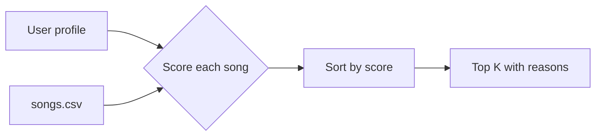

# 🎵 Music Recommender Simulation

## Project Summary

In this project you will build and explain a small music recommender system.

Your goal is to:

- Represent songs and a user "taste profile" as data
- Design a scoring rule that turns that data into recommendations
- Evaluate what your system gets right and wrong
- Reflect on how this mirrors real world AI recommenders

My version, **VibeMatch 1.0**, is a content-based recommender. It reads a catalog of songs from a CSV, compares every song to a user's taste profile, gives each one a score with the reasons behind it, and prints the top results in the terminal.

---

## How The System Works

### How real recommenders work

Apps like Spotify and YouTube mix two ideas:

- **Collaborative filtering** uses other people's behavior. If listeners who liked the songs I like also played a track I have not heard, it gets suggested to me. It needs a lot of history (plays, skips, likes, playlists) and it does not need to know anything about the song itself.
- **Content-based filtering** uses the song's own attributes (genre, mood, tempo, energy, acousticness) and compares them to what the user has liked before. It works for new songs with no history, but it tends to keep recommending more of the same.

In both cases there are three separate parts: the **input data** (song features and user behavior), the **user preferences** (a profile built from that behavior), and the **ranking** step that scores every candidate and keeps the best few.

My simulation is content-based only. There is no listening history, so the user profile is written by hand.

### Features

- `Song`: `genre`, `mood`, `energy`, `acousticness` are used for scoring. `tempo_bpm`, `valence` and `danceability` are loaded but not scored in the base recipe.
- `UserProfile`: `favorite_genre`, `favorite_mood`, `target_energy`, `likes_acoustic`.

### Algorithm recipe

For each song:

| Rule | Points |
| --- | --- |
| Genre matches the user's favorite | +2.0 |
| Mood matches the user's favorite | +1.0 |
| Energy closeness: `1 - abs(song energy - target energy)` | up to +1.5 |
| Acoustic fit (only if the user states a preference) | up to +0.5 |

Energy uses closeness, not size, so a user who wants 0.4 is not pushed toward the loudest songs. Genre is worth the most because it is the first thing I would filter on myself.

The **scoring rule** judges one song. The **ranking rule** sorts all scored songs from highest to lowest and returns the top `k`. Both are needed: a score alone says nothing until it is compared against the rest of the catalog.



### Bias I expect

Genre is an exact text match worth 2 points, so a great song in a neighboring genre ("indie pop" for a "pop" fan) loses to a weaker song with the right label. Genres with more songs in the catalog will also fill more of the top 5.

---

## Getting Started

### Setup

1. Create a virtual environment (optional but recommended):

   ```bash
   python -m venv .venv
   source .venv/bin/activate      # Mac or Linux
   .venv\Scripts\activate         # Windows

2. Install dependencies

```bash
pip install -r requirements.txt
```

3. Run the app:

```bash
python -m src.main
```

### Running Tests

Run the starter tests with:

```bash
pytest
```

You can add more tests in `tests/test_recommender.py`.

---

## Sample Recommendation Output

Paste a sample of your recommender's output here as a text block so a reader can see what it produces:

```
# e.g.:
# User profile: genre=indie, mood=chill, energy=low
# Recommendations:
#   1. ...
#   2. ...
#   3. ...
```

**Screenshot or video** *(optional)*: <!-- Insert a screenshot or demo video link here -->

---

## Experiments You Tried

Use this section to document the experiments you ran. For example:

- What happened when you changed the weight on genre from 2.0 to 0.5
- What happened when you added tempo or valence to the score
- How did your system behave for different types of users

---

## Limitations and Risks

Summarize some limitations of your recommender.

Examples:

- It only works on a tiny catalog
- It does not understand lyrics or language
- It might over favor one genre or mood

You will go deeper on this in your model card.

---

## Reflection

Read and complete `model_card.md`:

[**Model Card**](model_card.md)

Write 1 to 2 paragraphs here about what you learned:

- about how recommenders turn data into predictions
- about where bias or unfairness could show up in systems like this


